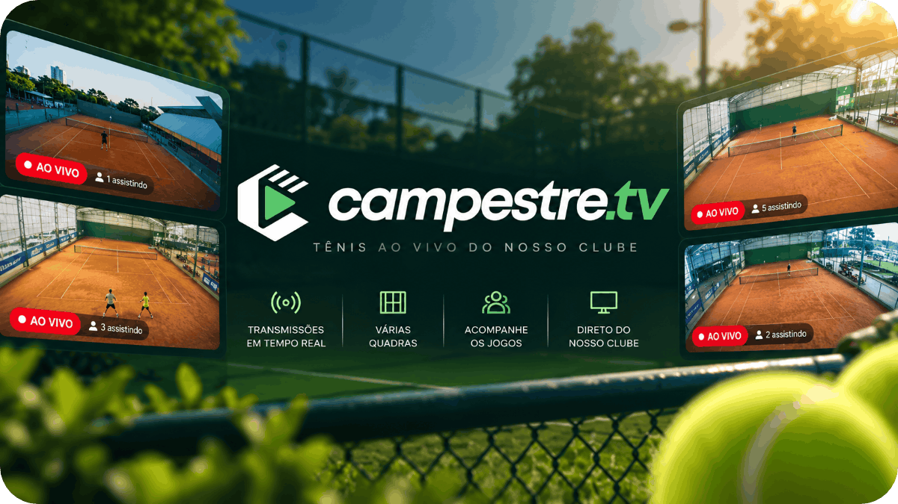

<p align="center">
  
</p>

<h1 align="center">
  Campestre TV
</h1>
<p align="center">Live tennis from the Campestre club courts.</p>

<p align="center">
  <a href="https://campestre.tv">Website</a>
  <span>&nbsp;•&nbsp;</span>
  <a href="https://youtube.com/@campestre-tv?sub_confirmation=1">YouTube</a>
</p>

<p align="center">
  
</p>

## Introduction

Campestre TV plays the club's tennis courts live in the browser. The page lists the courts that are on air and opens the one you pick, including a shared `?live=` link.

### :heart: Found this project useful?

If you found this project useful, then please consider giving it a :star: on GitHub and sharing it with your friends via social media. It helps to promote the project and attract more contributors.

## What it does

- Lists the courts currently live on the Campestre TV YouTube channel
- Plays the selected court in the page
- Opens the court from a shared `?live=` link, such as `?live=8`
- Shares that link by copy, WhatsApp, Telegram, or the system share sheet

## Tech stack

- [Next.js](https://nextjs.org) 16 and React 19
- Tailwind CSS 4
- [shadcn/ui](https://ui.shadcn.com) on [Base UI](https://base-ui.com)
- [nuqs](https://nuqs.dev) for the `?live=` court link
- YouTube Data API v3 for public live-stream data
- Vitest for unit tests

## Requirements

- [pnpm](https://pnpm.io). The install script allows only pnpm.
- Node.js 20+

## Development

```bash
pnpm install
cp .env.example .env
pnpm dev
```

`pnpm dev` runs through [portless](https://portless.sh) at `https://campestre-tv.localhost`.

Add `YOUTUBE_API_KEY` to `.env` before the live courts can load. The key stays on the server. Do not prefix it with `NEXT_PUBLIC_`.

`pnpm build` then `pnpm start` serves the production build the same way, through portless.

## Scripts

| Script         | Description                                 |
| -------------- | ------------------------------------------- |
| `dev`          | Start the app at campestre-tv.localhost     |
| `dev:next`     | Next.js only, without portless              |
| `build`        | Build the production app                    |
| `start`        | Serve the production build through portless |
| `start:next`   | Serve the production build without portless |
| `lint`         | Run ESLint                                  |
| `lint:fix`     | Run ESLint and apply fixes                  |
| `format`       | Format files with Prettier                  |
| `format:check` | Check formatting without writing            |
| `test`         | Run unit tests with Vitest                  |
| `typecheck`    | Type-check the project with `tsc`           |
| `check:fix`    | Format, lint fix, and type-check            |
| `clean`        | Remove build artifacts                      |

## YouTube Data API

The app reads public video and live-stream data through the YouTube Data API v3. The browser only talks to this app.

### Create a key

1. Open [Google Cloud Console](https://console.cloud.google.com/) and create or select a project.
2. Enable **YouTube Data API v3**.
3. Create an API key under **APIs & Services → Credentials**.
4. Restrict the key to YouTube Data API v3. This integration does not use OAuth and only requests public video data.

### Configure

```bash
YOUTUBE_API_KEY=your-key
YOUTUBE_CHANNEL_ID=UCdWZMGfre33FZdDgcd1dz-A
YOUTUBE_CHANNEL_VIDEO_LIMIT=50
```

`YOUTUBE_CHANNEL_ID` is the public channel to watch. Change it in `.env` when the channel changes. `YOUTUBE_CHANNEL_VIDEO_LIMIT` is how many recent uploads to inspect. It defaults to 50, which is one playlist page. `.env.example` lists the names. Do not commit a real key.

### Videos

```http
GET /api/youtube/videos?ids=VIDEO_ID_1,VIDEO_ID_2
```

Pass up to 50 video ids, separated by commas. The response is not cached, so a later client can poll it. A 30–60 second interval is enough for concurrent viewer counts. `videos.list` costs 1 quota unit per request. The default daily quota is 10,000 units.

`fetchYouTubeVideos` in `src/lib/youtube/fetch-videos.ts` is the same call from the browser.

`live.status` is `live`, `upcoming`, `completed`, or `none`. Counts and live times are omitted when YouTube does not send them. A missing count is not `0`. Videos that are private, deleted, or unknown are left out.

### Channel

```http
GET /api/youtube/channel
```

An optional `channelId` query overrides the configured channel:

```http
GET /api/youtube/channel?channelId=UCdWZMGfre33FZdDgcd1dz-A
```

Discovery uses public data only. The uploads playlist id is the channel id with the `UC` prefix replaced by `UU`, so the app does not call `channels.list` or `search.list`. `search.list` costs 100 quota units. Each poll instead calls `playlistItems.list` (1 unit) and then `videos.list` (1 unit) for live details such as concurrent viewers. At a 60 second interval that is about 2,880 units per day, inside the default 10,000 unit quota.

The response keeps broadcasts whose status is `live`, `upcoming`, or `completed`, with live streams first. Ordinary uploads are left out. `liveCount` is the number of videos currently live. `courtName` is set only when the title contains exactly one `Quadra N`, for example `Campestre TV - Quadra 1` becomes `Quadra 1`. Otherwise `courtName` is `null`.

`fetchYouTubeChannel` in `src/lib/youtube/fetch-channel.ts` calls this endpoint from the browser.

## License

This project is licensed under the MIT License - see the [LICENSE](./LICENSE) file for details.
